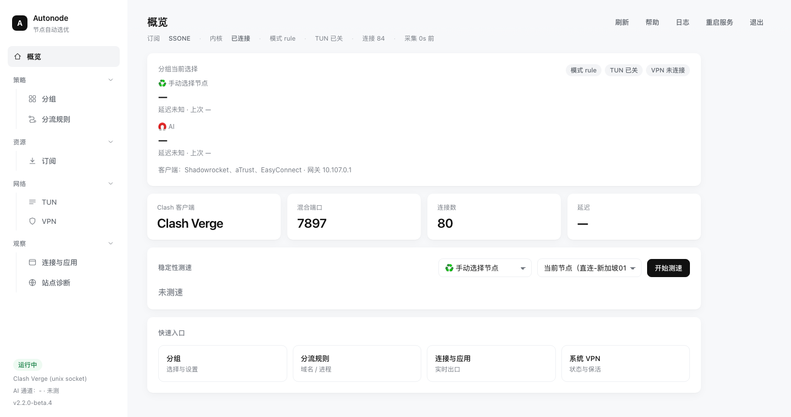

# Autonode

<p align="center">
  
</p>

<p align="center">
  给 Clash 系客户端的「AI 通道 + 节点自动选优」工具。<br>
  本地网页控制台，纯标准库，不碰系统网络设置。
</p>

---

## 界面

<p align="center">
  
</p>

浅色、卡片化、近乎无色的界面；只有关键状态（运行中 / TUN 开关 / 错误）带一点颜色。
更多截图见 [docs/screenshots](docs/screenshots)。

## 解决什么

AI 站点（ChatGPT / Claude / Gemini）会查 IP 异常，**频繁换节点反而更容易掉登录**；
但节点又会挂，24×7 挂着不可能手动盯着。

Autonode 的原则是 **稳定优先于快**：

- **AI 分组粘滞**：验证通过就绝不换节点，只在失效时切
- **通用分组择优**：按延迟自动挑，带防抖，不会来回跳
- **出问题能定位**：哪个站打不开、哪些节点能开、现在走哪条线

## 核心功能

- 🧲 **AI 通道**：独立角色，验证地址可选 ChatGPT / Claude / Gemini / 自定义
- 🔁 **自动选优**：定时测速 + 防抖 + 死节点回退
- 🔀 **分流规则**：域名 / IP / 进程 → 直连、拒绝或指定分组
- 🔍 **站点诊断**：粘贴网址，测出哪些节点能打开
- 📥 **订阅导入**：校验后交给客户端（Verge 支持一键导入）

## 安装

**macOS** — 下载 [最新 Release](https://github.com/shwenyu/Autonode/releases/latest) 的 `Autonode-<version>.pkg`，双击（未签名，首次右键 → 打开）。

装完得到两样东西：

- `/Applications/Autonode.app` —— 双击打开控制台（原生窗口）
- 后台服务 —— 登录自启，负责定时选节点；**关窗口不影响它**

也可以直接浏览器访问 <http://127.0.0.1:8765>。

**Windows** — 下载 `autonode-windows-<version>.zip`，双击 `install.cmd`（自带 exe，无需安装 Python）。

## 使用逻辑（三句话）

1. **分组**决定"哪些节点参与自动选"，AI 分组建议只放固定的几条线
2. **分流规则**决定"哪些域名走哪个分组"（比如 `claude.ai → AI-Claude`）
3. **验证地址**决定"这个节点还算不算可用"——AI 分组靠它判断要不要换

三者独立：改分流不会影响选优，改选优不会影响路由。

## 支持的客户端

Clash Verge / ClashX / Stash / Clash for Windows / mihomo —— 通过 `external-controller` 通信，自动探测 unix socket 或 TCP 端口。

## 3.0 路线

当前处于 3.0 alpha：统一运行快照、运行代次、配置 revision、操作记录、导航重构（概览/策略/资源/网络/观察）。
详见 [docs/ROADMAP-3.0.md](docs/ROADMAP-3.0.md)。

## 兼容性

| 客户端 | 支持 |
|---|---|
| Clash Verge Rev（macOS / Windows / Linux） | 完整（分组、规则模板、订阅切换） |
| mihomo 独立进程 | 分组选优可用；规则模板需手动指定 |
| ClashX / ClashX Pro | 分组选优可用（自动探测配置目录） |
| 其他 Clash 内核 | 通过 TCP 控制器（9090 等）只读接管选优 |

自动探测：配置目录候选覆盖 `~/.config/clash`、`~/.config/mihomo`、ClashX、Verge 各平台路径；控制器优先 unix socket，其次常见 TCP 端口。
写模板、切订阅这类能力依赖 Clash Verge 的 `profiles.yaml` 结构，其他客户端会自动降级为只读或提示。

## 订阅记忆

每个订阅的「纳管分组绑定」会按订阅 uid 记住：

- 切订阅后自动恢复该订阅上次的绑定
- 分流规则同样按订阅记忆（`sub_routes`），切换后自动换回该订阅的规则；目标不存在的规则会自动迁到已绑定分组
- 没有记忆时按角色关键词自动匹配（AI → 含 AI/GPT 的分组；通用 → 手动选择类分组）
- 都匹配不到才提示「绑定失效」，由你手动选

## 安全

- 控制台只监听 `127.0.0.1`，校验 `Host`/`Origin`，防止 CSRF 与 DNS rebinding
- 订阅内容一律转义后渲染，避免机场侧注入脚本
- 更新下载限制在 GitHub 域名，安装前需管理员授权
- 完整自查报告：[docs/SECURITY.md](docs/SECURITY.md)

## 数据与隐私

全部本地运行：只读客户端接口，不上传数据。唯一网络请求是测速地址和你主动填写的订阅链接。

配置在 `~/.config/autonode/`（macOS）或 `%APPDATA%\autonode\`（Windows）。

## 开发

```bash
python3 autonode.py --serve     # 控制台 + 调度
python3 autonode.py --once      # 跑一轮
python3 autonode.py --dry-run   # 只测不切
python3 tests/test_dryrun.py    # 回归测试
```

发布：`git tag v1.2.1 && git push origin v1.2.1`，Actions 自动构建 pkg 和 Windows 包。

## 许可证

MIT
